# Pyro — Phases to v0.1

| | |
|---|---|
| **Status** | Phase 2 next (2026-10-18) |
| **Source of truth** | [`project-plan.md`](project-plan.md) §14 owns scope, estimates and build order; this file only groups that order into phases and tracks progress |
| **Sync rule** | When §14 changes (an item, an estimate, the order), change this file in the same commit. When an item here is finished, tick it here; §14 changes only if its scope or estimate changed |

The road from the spikes to the first public release, in the order §14 builds it. Work-item numbers
(`#2`, `#7`, …) are §14's v0.1 numbers. Estimates are evenings (~3 hours, ~3 a week) without the
1.3–1.5× solo overrun §14 warns about.

**Legend:** ✅ done · 🔶 partly done · ⬜ not started · ❓ status unknown

---

## At a glance

```mermaid
flowchart LR
  P0["Phase 0<br/>De-risking spikes ✅"] --> P1["Phase 1<br/>Foundations 🔶"]
  P1 --> P2["Phase 2<br/>Data contract ⬜"]
  P2 --> P3["Phase 3<br/>Vertical slice ⬜"]
  P3 --> P4["Phase 4<br/>Editor ⬜"]
  P4 --> P5["Phase 5<br/>Play and shell ⬜"]
  P5 --> M1(["Early preview"])
  M1 --> P6["Phase 6<br/>Testers and feedback ⬜"]
  P6 --> P7["Phase 7<br/>Design pass and assets ⬜"]
  P7 --> P8["Phase 8<br/>Deferred breadth ⬜"]
  P8 --> P9["Phase 9<br/>Release ⬜"]
  P9 --> M2(["v0.1"])
```

| Phase | Contents (§14 items) | Evenings | Left | Status |
|---|---|---|---|---|
| 0 — De-risking spikes | v0.0 spikes #1–#3 | ~4 | 0 | ✅ |
| 1 — Foundations | #0 repo setup, #14 design system (all of it) | 3 + 23 | Riverpod spike | 🔶 |
| 2 — Data contract | #2 Document model, #7 Generator, #8 Runtime | 13 | 13 | ⬜ |
| 3 — Vertical slice | First slice of #11 | (in #11) | — | ⬜ |
| 4 — Editor | #6, #4, #3, #5, #9 | 15 | 15 | ⬜ |
| 5 — Play and shell | Rest of #11 (preview part), #1 (preview part) | 6 | 6 | ⬜ |
| **Early preview** | | **~42** | **~34** | |
| 6 — Testers and feedback | 5–8 testers, pivot table | — | — | ⬜ |
| 7 — Design pass and assets | #14 panels onto the design system, #10 | 2.5 + ? | 2.5 + ? | ⬜ |
| 8 — Deferred breadth | Deferred parts of #1, #2, #3, #4, #5, #6, #7, #8, #9, #11 | ~20.5 | ~20.5 | ⬜ |
| 9 — Release | #15, #12, #13, #14 final pass, #16 | 9 | 9 | ⬜ |
| **v0.1** | | **~92** | **~66** | |

**Left to the early preview:** ~34 evenings ≈ 11 weeks, ~16 weeks with a 1.4× overrun.
**Left to v0.1:** ~66 evenings ≈ 22 weeks, ~31 weeks with a 1.4× overrun. Of the ~92, the
~26 already done are the repo setup and the whole design system (the spikes come on top): #14 was
planned as a ~5.5-evening core in the preview plus ~17.5 after it, and all ~23 are built.

"?" is the work of moving the preview's panels from Material widgets onto the design system,
which §14 orders but doesn't estimate (see [Open questions](#open-questions)).

---

## Phase 0 — De-risking spikes ✅

Throwaway code in `spikes/`, findings in [`ARCHITECTURE.md`](ARCHITECTURE.md) (*Q42, Q69*).

- [x] Spike #1: Play, Hot-swap and Attach (*Q74, Q81*); `spikes/01_play_hotswap/`
- [x] Spike #2: generator shape and watch latency (*Q76, Q77*); `spikes/02_generator/`
- [x] Spike #3: disk rendering (*Q78, Q79*); `spikes/03_disk_render/`

**Done when:** every item in §15.3 is ticked. ✅

## Phase 1 — Foundations 🔶

- [x] **#0 Repo setup:** pub workspace, the four packages and the app, CI skeleton, lint rules
- [ ] **#0 Riverpod learning spike** (Q26, §8.5): Riverpod isn't a dependency yet
- [x] **#14 Design system** in `pyro_ui` (*Q83, Q84*): foundations, all 29 components,
  the EditorShell, the 60 icons, the gallery app, widget tests, one golden per gallery page and the
  side-by-side review against `preview.html` ([`ui-components-plan.md`](ui-components-plan.md))

Free tasks §14 lists before building:

- [x] Ask the Flame maintainers about the name (*Q36*): "Flame Studio" is reserved for their
  official package, so the app is now **Pyro** (*Q86*)
- [ ] ❓ Post the spike #1 loop as a short GIF on the Flame Discord (a demand check)

**Done when:** the Riverpod spike has settled the provider layout of §8.5 well enough to start
Phase 2.

## Phase 2 — Data contract ⬜

The file formats and the code on both sides of them. Integrity is never cut here (*Q82*).

- [ ] **#2 Document model** (4.5): `SceneDocument` (freezed, flat `NodeId → Node` map), named
  transactions, undo/redo with coalescing, dirty flag, atomic save/load, recovery file (*Q55, Q85*),
  `schemaVersion` gate (*Q49*). *Deferred:* migrations framework. §8.1, §8.2, §7.1
- [ ] **#7 Generator** (4.5): introspection, Type IDs + collisions (ADR 0002), supertypes (*Q57*),
  Registry + Manifest emitters into `lib/` (*Q68*), error reporting, goldens, for the preview's
  Field types. §6.1, §7.3, §9.2
- [ ] **#8 Runtime** (4, full scope): loader, two-pass references, assets (the *Q78* Tiled loader),
  lookup API, unknown-type handling (*Q58*), Hot-swap (`onHotReload`, content hash, `onReloaded`;
  *Q66, Q67, Q71*). §6.2, §9.3

**Done when:** a scene round-trips through the Document model unchanged, the generator's goldens
pass on annotated fixtures, and the Runtime loads fixture scenes with `flame_test` (§13).

## Phase 3 — Vertical slice ⬜

- [ ] A hand-written Scene JSON → generator → Runtime → Play → Hot-swap, with no editor UI
  (the first slice of #11)

**Done when:** editing the JSON by hand and saving swaps the scene in the running game. This
removes the integration risk the spikes couldn't, and the author becomes the first user.

## Phase 4 — Editor ⬜

In §14's order. The design-system widgets these panels need (`PrTreeRow`, `PrPropertyRow`,
`PrNumberProperty`, `PrVector2Property`) are already built.

- [ ] **#6 Built-in Node kinds** (2): entity, sprite, rectangle and circle hitboxes, placeholders
- [ ] **#4 Viewport** (6.5): preview world, reconciler, pan/zoom, selection, move gizmo. §8.3
- [ ] **#3 Hierarchy** (2): add, delete, rename, reparent by drag
- [ ] **#5 Inspector** (2.5): transform; editors for `int`, `double`, `bool`, `String`, enum,
  `Vector2` and an asset-path dropdown; Override markers + *Reset to default* (ADR 0003). Other
  Field types show read-only and round-trip untouched. §8.4
- [ ] **#9 Behaviors in the inspector** (2): add/remove, compatibility filtering, Missing behavior
  state

**Done when:** a scene can be built from scratch in Pyro (entity, sprite, hitbox, custom
Behavior with edited fields), saved, and reopened unchanged.

## Phase 5 — Play and shell ⬜

- [ ] **#11 Play, rest of the preview part** (4 with the slice): macOS desktop target by default
  (⚠ verify Hot-swap there first, ~0.5), daemon client, Console, Hot-swap trigger, auto code
  reload (*Q61*), build_runner lock/external mode (*Q48, Q77*), *Attach debugger* copying the
  current URI (*Q81*), image-restart toast (*Q72*). §9
- [ ] **#1 App shell, preview part** (2): project list, open project, basic SDK detection, Runtime
  compatibility check (*Q49*)
- [ ] README recipe for adding Pyro to a project (stands in for the "Add Pyro" flow)

**Done when:** the tester task works end to end in a project other than the author's: open a Flame
project, place an entity with a sprite and a hitbox, attach a custom Behavior, tweak its fields,
press Play and see the change in the running game.

## 🚩 Early preview

Built from source, no signing, macOS. Everything above is in; nothing below is.

## Phase 6 — Testers and feedback ⬜

- [ ] 5–8 hand-picked developers on their own games, a few watched on a call (*Q82*)
- [ ] Record time from install to the first running scene, where setup failed, and whether they
  would use it over editing Dart
- [ ] Ask about stale references after Hot-swap (Q-I, *Q71*)
- [ ] Apply the response table fixed in advance in §14 (fix setup first, pull node-level patching
  forward, re-examine the viewport, reorder v0.1, or continue as planned)

**Done when:** each observation has its response, and the order of Phases 7–8 is confirmed or
changed in §14 (and here).

## Phase 7 — Design pass and assets ⬜

- [ ] **#14 Panels onto the design system:** replace the preview's Material widgets with the `Pr`
  widgets, starting with Button, IconButton, Tooltip, TextField, Panel, SectionHeader,
  ContextMenu, Dropdown, BoolProperty, Dialog, Toast, Badge, Banner, Progress, then EditorShell,
  Toolbar, Tabs (`ui-components-plan.md` §8.3). The widgets exist; this is the switch
- [ ] **#10 Asset browser + pubspec sync** (2.5), incl. subfolders and the "Not in pubspec.yaml"
  mark (*Q53, Q85*). §10

## Phase 8 — Deferred breadth ⬜

The parts of each item the preview cut. Their order stays open until Phase 6's feedback (*Q82*).

- [ ] **#1 App shell** (4): "Add Pyro" flow + pubspec diff, SDK management, settings, About
  window with licences
- [ ] **#2 Document model** (0.5): migrations framework (§7.4)
- [ ] **#3 Hierarchy** (1.5): duplicate, filter, duplicate-name warning (*Q51*)
- [ ] **#4 Viewport** (3.5): grid, snapping, rotate/scale gizmos; the reference rectangle (*Q85*, §8.3),
  which §14 doesn't place yet
- [ ] **#5 Inspector** (2): editors for `Color`, entity reference, `Sprite`, `SpriteAnimation`
- [ ] **#6 Built-in Node kinds** (0.5): the third hitbox kind
- [ ] **#7 Generator** (2): the rest of the v1 Field types
- [ ] **#8 Runtime** (0.5): the difference between §14's preview and v0.1 estimates
- [ ] **#9 Behaviors** (1): reorder, Missing behavior polish
- [ ] **#11 Play** (5): device list + emulator boot (*Q62*), Attach info file, `launch.json`,
  unauthenticated mode (*Q81*), lifecycle (*Q63*)

## Phase 9 — Release ⬜

In §14's order:

- [ ] **#15 Signing, notarization, release pipeline** (3)
- [ ] **#12 CI contract test** (1) (*Q59*)
- [ ] **#13 `example/` game** (2)
- [ ] **#14 final pass** against the design (goldens already exist; re-check the panels)
- [ ] **#16 README, Getting Started** (incl. Attach and the CI check), demo video,
  `ARCHITECTURE.md` polish (3)

## 🏁 v0.1 — First public release (macOS)

Signed and notarized, on GitHub Releases. After it: v0.1.1, v0.2, … as in §14's
"Roadmap after v0.1".

---

## Open questions

- **Preview panels on Material or on the design system?** §14 (*Q82, Q84*) has the preview use
  themed Material widgets and move to the design system after it, because only a ~5.5-evening core
  of #14 was to be built first. All of #14 is now built, so the preview could use the `Pr` widgets
  from the start and Phase 7's switch would disappear. Not decided; §14 and Phase 7 stay as they
  are until it is.
- **The Discord GIF** in Phase 1: done or not?

The phase estimates are the per-item figures in §14's two tables. Phase 8's #7 and #8 lines are
the differences between those tables, so they are rough.
