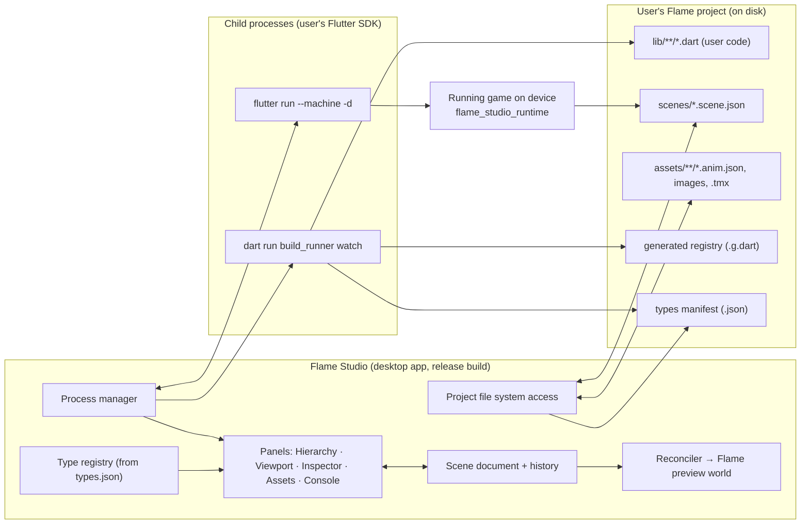
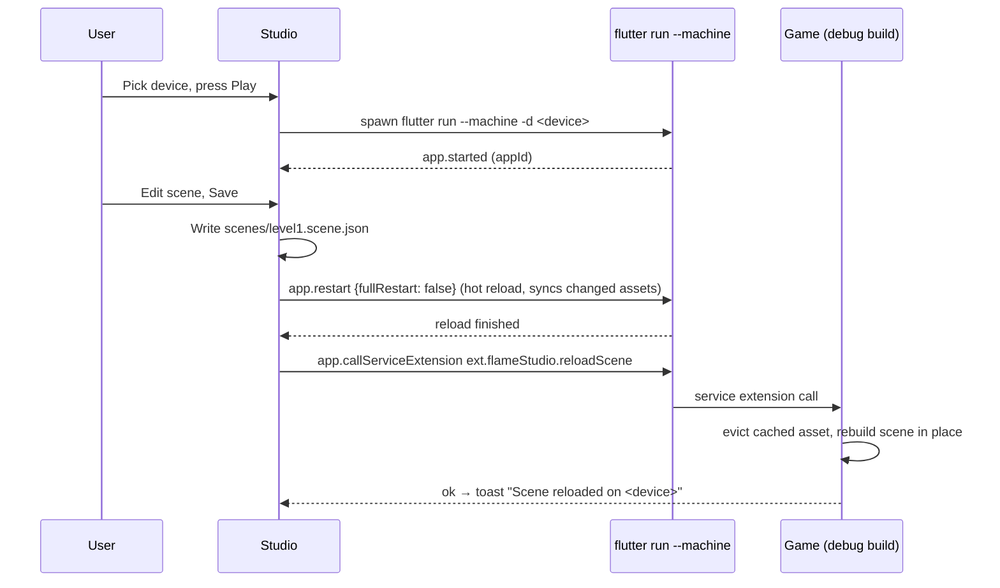

# Flame Studio — Project Plan

| | |
|---|---|
| **Status** | Draft for review |
| **Date** | 2026-10-16 |
| **Author** | Salah Ahmed |
| **Companion docs** | [`decisions.md`](decisions.md) (decision log, Q1–Q42) · [`claude-design-prompts.md`](claude-design-prompts.md) (UI design prompts) |

> **For reviewers.** Everything in sections 1–13 was decided in a structured design session; the
> decision number (e.g. *Q17*) points to the entry in `decisions.md`. Items marked **⚠ verify**
> are assumptions the v0.0 prototype must confirm. Items marked **◇ proposed** are details
> worked out while writing this plan that were *not* explicitly decided yet — review these
> hardest. Section 15 lists the open questions.

---

## Contents

1. [Summary](#1-summary)
2. [Goals and non-goals](#2-goals-and-non-goals)
3. [Users and the core workflow](#3-users-and-the-core-workflow)
4. [Architecture](#4-architecture)
5. [Repository and packages](#5-repository-and-packages)
6. [User-facing API](#6-user-facing-api)
7. [Data formats](#7-data-formats)
8. [Editor internals](#8-editor-internals)
9. [Process orchestration](#9-process-orchestration)
10. [Asset pipeline](#10-asset-pipeline)
11. [Code/data drift and error handling](#11-codedata-drift-and-error-handling)
12. [Platforms, packaging and distribution](#12-platforms-packaging-and-distribution)
13. [Testing and CI](#13-testing-and-ci)
14. [Milestones and work breakdown](#14-milestones-and-work-breakdown)
15. [Risks, open questions and items to verify](#15-risks-open-questions-and-items-to-verify)
16. [Glossary](#16-glossary)

---

## 1. Summary

Flame Studio is an **open-source desktop editor for games made with the [Flame](https://flame-engine.org)
engine** (Flutter). It gives Flame developers what Unity and Godot users take for granted: a scene
editor where you compose levels visually, attach behaviors, tweak their fields in an inspector,
and press Play to run the game on a real device — while all game **logic stays in plain Dart**,
written in the developer's own IDE.

Key architectural choices:

- **Standalone app** (*Q7*). The studio never runs user code. It edits *data* (scene files) and
  launches the user's game as a child process via the user's own Flutter SDK.
- **Data-driven scenes** (*Q3*). Scenes are JSON files loaded at runtime by a small package,
  `flame_studio_runtime`, through a non-invasive API.
- **Code generation instead of reflection** (*Q12, Q38*). A `source_gen` builder,
  `flame_studio_generator`, reads annotated user classes and emits (a) a runtime registry used by
  the game to instantiate scene objects and (b) a JSON manifest the studio reads to build its
  inspector.
- **Behaviors-first scripting** (*Q6, Q13*) on top of `flame_behaviors`.

It is built solo, on evenings and weekends (*Q5*), MIT-licensed (*Q11*), macOS-first (*Q4*).

---

## 2. Goals and non-goals

### Goals

1. **Compose in the GUI, logic in Dart, see it live on a device.** This loop is the product.
2. Work with **any existing Flame project** without restructuring it (*Q29, Q30*).
3. **Never destroy user data**: scene files survive code renames, deletions and studio upgrades
   (*Q32, Q35*).
4. Be **maintainable by one person**: narrow version support, few moving parts, strong tests on the
   core (*Q18, Q33*).
5. Be **contributor-friendly**: a normal Flutter desktop app, documented architecture (*Q37*).

### Non-goals (for v1)

| Not doing | Why / instead |
|---|---|
| Code editor, IDE features | VS Code / Android Studio already do this well (*Q2*) |
| Visual scripting | Logic is Dart (*Q2*) |
| Tilemap editing | Use Tiled; the studio *places* Tiled maps as nodes (*Q10*) |
| Pixel/image drawing | Use Aseprite etc.; the studio slices and imports (*Q8*) |
| Running user code inside the editor | Isolation and plugin compatibility (*Q7, Q16*); the v0.4 live bridge covers the need |
| Forge2D physics editing | Built-in Flame hitboxes first (*Q9*) |
| Docking/tabbed panel framework | Fixed resizable panels (*Q20*) |
| 3D | Flame is 2D |

---

## 3. Users and the core workflow

**Primary user:** a Dart/Flutter developer making a 2D game with Flame, comfortable with code,
frustrated by placing objects with hard-coded coordinates and restarting the game to tweak values.

### The core loop (v0.1)

1. Open the studio → pick a Flame project from the project list.
2. First time only: **"Add Flame Studio to this project"** adds two dependencies, `build.yaml`
   and a `scenes/` folder, shows the diff, runs `pub get` (*Q29*).
3. The studio starts `build_runner watch` in the background. The user's annotated behaviors and
   components appear in the "Add Behavior" list (*Q38*).
4. Create a scene; drag images in from the asset browser; arrange entities with gizmos; add
   hitboxes; attach behaviors and set their fields in the inspector.
5. In their IDE, the user writes `@StudioBehavior() class Patrol extends Behavior<...>` with
   `@Editable() double speed = 50;` → saves → seconds later `speed` is editable in the inspector.
6. In game code: `world.add(await StudioScene.load('scenes/level1.scene.json'))` (*Q30*).
7. Pick a device in the toolbar (iOS simulator, Android emulator, macOS, a phone) → **Play**
   (*Q17, Q41*).
8. While the game runs, edit the scene and save → the scene **hot-swaps** on the device in about
   a second.

---

## 4. Architecture

### 4.1 Process and component view



### 4.2 Components and responsibilities

| Component | Where it runs | Responsibility |
|---|---|---|
| **Studio app** (`flame_studio`) | User's desktop, release build | Project list, editing, preview rendering, orchestrating child processes. Never imports user code. |
| **Scene document** | Studio | Immutable model of the open scene; single source of truth (*Q21*). |
| **Reconciler** | Studio | Turns document changes into minimal changes to a Flame `World` used as the viewport (*Q24*). |
| **Type registry (studio side)** | Studio | Parsed from the manifest; drives inspector field editors and the "Add Behavior/Component" lists. Built-in Flame types use hand-written descriptors (*Q12*). |
| **Process manager** | Studio | Spawns and supervises `build_runner watch` and `flutter run --machine`; parses their output into the Console (*Q29*). |
| **`flame_studio_generator`** | User project, dev dependency | `source_gen` builder: emits the runtime registry and the types manifest (*Q38*). |
| **`flame_studio_runtime`** | Shipped inside the user's game | Annotations, scene loader, migrations, lookup API, debug-only reload hook (*Q30*). |

### 4.3 Why this shape (short rationale for reviewers)

- **Isolation:** user code can't crash or hang the editor; editor bugs and user bugs stay separate.
- **Compatibility:** the user's project never has to build for desktop, so mobile-only plugins (ads,
  some analytics SDKs) don't block the studio.
- **Performance:** the studio is an AOT release build (smooth UI), unlike an editor compiled into
  the user's project, which would have to run in debug/JIT mode for hot reload.
- **No reflection in Flutter:** `dart:mirrors` is unavailable, and `reflectable` was evaluated and
  rejected (generic-type limits, per-entry-point generation, runtime cost in shipped games).
  Full rationale: `decisions.md` Q12, Q38 and the session's comparison artifact.
- **Cost accepted:** custom components with bespoke rendering appear as placeholders in the
  editor; Play is always a separate process. The v0.4 live bridge reduces both.

---

## 5. Repository and packages

One repository, **Dart pub workspaces** (*Q28*).

```
flame_studio/                      ← repo root (this folder)
├─ pubspec.yaml                    ← workspace root
├─ docs/
│  ├─ project-plan.md              ← this document
│  ├─ decisions.md
│  ├─ claude-design-prompts.md
│  └─ ARCHITECTURE.md              ← written from v0.0 findings + this plan
├─ packages/
│  ├─ flame_studio_runtime/        ← pub.dev; shipped in games
│  │  ├─ lib/src/annotations.dart
│  │  ├─ lib/src/scene/            ← model, JSON (de)serialization, migrations
│  │  ├─ lib/src/loader/           ← StudioScene.load, AssetSource, registry interface
│  │  └─ lib/src/debug/            ← hot-swap service extension (debug only)
│  └─ flame_studio_generator/      ← pub.dev; dev dependency
│     ├─ lib/builder.dart
│     └─ lib/src/{introspect,registry_emitter,manifest_emitter}.dart
├─ apps/
│  └─ flame_studio/                ← the desktop app (released as binaries, not on pub)
│     ├─ lib/app/                  ← shell, project list, settings
│     ├─ lib/document/             ← document model, transactions, history
│     ├─ lib/viewport/             ← preview world, reconciler, gizmos
│     ├─ lib/panels/               ← hierarchy, inspector, assets, console
│     ├─ lib/project/              ← SDK detection, setup flow, pubspec sync
│     └─ lib/process/              ← build_runner + flutter daemon clients
└─ example/                        ← sample Flame game built with the studio
```

**Shared code:** the scene model, JSON format and migrations live in `flame_studio_runtime` and are
imported by the studio, so the studio and games can never disagree on the format.

**Dependency rules**
- `flame_studio_runtime` depends only on `flame`, `flame_behaviors` and Flutter. Keep it small:
  it ships in every game.
- `flame_studio_generator` depends on `source_gen`, `build`, `analyzer` and the runtime (for the
  annotation types).
- The app depends on the runtime (format, built-in rendering), `flame`, `flame_tiled`, Riverpod,
  freezed. It **never** depends on the generator.

---

## 6. User-facing API

All names are **◇ proposed**; the shape is decided.

### 6.1 Annotations (in `flame_studio_runtime`)

```dart
@StudioBehavior(
  label: 'Patrol',                 // optional display name
  category: 'Movement',            // groups the Add Behavior list
)
class Patrol extends Behavior<PositionedEntity> {
  @Editable(min: 0, max: 400, tooltip: 'Pixels per second')
  double speed = 50;

  @Editable()
  Vector2 direction = Vector2(1, 0); // non-const default → shown as "default from code"

  @Editable()
  PatrolMode mode = PatrolMode.pingPong; // enum → dropdown

  @Editable()
  Player? target;                  // Component subtype → entity reference picker

  @Editable()
  SpriteAnimation? hitEffect;      // asset reference, loaded by the runtime

  @override
  void update(double dt) { /* user logic */ }
}

@StudioComponent(preview: 'images/boss_preview.png') // drawn in the editor instead of a placeholder
class Boss extends PositionedEntity { ... }
```

**Generator rules** (enforced at build time with clear errors):
- Annotated classes must be public, non-abstract, with an **unnamed constructor callable with no
  arguments**.
- `@Editable` fields must be public, non-final, of a supported kind: `int`, `double`, `bool`,
  `String`, enums, `Vector2`, `Color`, asset types (`Sprite`, `SpriteAnimation`, image path),
  or a `Component` subtype (entity reference) (*Q12*).
- Unsupported types (e.g. `Map`, `List` in v1) fail the build with a message pointing at the field.
- The behavior's **required parent type** (`Behavior<Enemy>`) is recorded in the manifest so the
  inspector only offers behaviors compatible with the selected node. ◇ proposed

### 6.2 Runtime API (in games)

```dart
import 'package:flame_studio_runtime/flame_studio_runtime.dart';
import 'flame_studio.g.dart'; // generated registry

class MyGame extends FlameGame {
  @override
  Future<void> onLoad() async {
    final scene = await StudioScene.load(
      'scenes/level1.scene.json',
      registry: studioRegistry,          // generated
    );
    world.add(scene);

    final player = scene.find<Player>('player');   // by node name
    final enemies = scene.findAll(tag: 'enemy');   // by tag
  }
}
```

- **Non-invasive:** no base class, works in any `FlameGame` (*Q30*).
- **Loading order:** construct all nodes → assign `@Editable` values and load asset fields →
  resolve entity references (second pass) → add to the tree, so `onLoad` sees configured fields.
  ◇ proposed
- **Debug-only hot-swap:** in debug builds the runtime registers a service extension
  (e.g. `ext.flameStudio.reloadScene`). The studio calls it after a hot reload; the runtime evicts
  the cached scene asset and rebuilds the scene in place. Compiled out of release builds. ◇ proposed,
  **⚠ verify** (v0.0 spike #1)
- **Typed accessors** (`Level1Scene.player`) are a later addition (v0.4).

---

## 7. Data formats

### 7.1 Scene file (`*.scene.json`) (*Q14, Q15, Q27*)

Pretty-printed, **keys sorted**, one node per block, paths relative to the project root.

```json
{
  "schemaVersion": 1,
  "nodes": {
    "3f1c…": {
      "behaviors": [
        {
          "fields": { "mode": "pingPong", "speed": 80, "target": { "ref": "9b2e…" } },
          "type": "package:my_game/behaviors/patrol.dart#Patrol"
        }
      ],
      "childIds": ["a71d…"],
      "kind": "entity",
      "name": "goblin_1",
      "parentId": "root",
      "tags": ["enemy"],
      "transform": { "angle": 0, "anchor": "center", "position": [320, 128], "scale": [1, 1], "size": [32, 32] }
    },
    "a71d…": {
      "kind": "rectangleHitbox",
      "name": "body",
      "parentId": "3f1c…",
      "props": { "collisionType": "active", "size": [24, 30] }
    },
    "c004…": {
      "kind": "prefabInstance",
      "name": "goblin_2",
      "overrides": {},
      "parentId": "root",
      "prefab": "scenes/prefabs/goblin.scene.json"
    }
  },
  "root": { "childIds": ["3f1c…", "c004…", "9b2e…"] }
}
```

- **Only overridden field values are stored.** Fields not present use the default from code.
- Type identifiers are fully qualified (`package:…#Class`) so classes with the same name in
  different libraries don't collide. ◇ proposed
- Prefab instances (`kind: prefabInstance`, v0.2) already carry an `overrides` map so per-instance
  overrides (v0.4) need no format change (*Q15*).

### 7.2 Animation file (`*.anim.json`) (*Q8, Q27*)

```json
{
  "schemaVersion": 1,
  "image": "assets/images/goblin_sheet.png",
  "grid": { "cellSize": [32, 32], "offset": [0, 0], "spacing": [0, 0] },
  "animations": {
    "walk": { "frames": [4, 5, 6, 7], "stepTime": 0.1, "loop": true },
    "idle": { "frames": [0, 1], "stepTimes": [0.4, 0.2], "loop": true }
  }
}
```

One file per spritesheet holding several named animations. ◇ proposed (one-file-per-sheet vs
one-file-per-animation is not yet decided — see §15).

### 7.3 Types manifest (generator → studio) (*Q38*)

```json
{
  "manifestVersion": 1,
  "generatedAt": "2026-10-16T10:12:03Z",
  "types": [
    {
      "id": "package:my_game/behaviors/patrol.dart#Patrol",
      "kind": "behavior",
      "label": "Patrol",
      "category": "Movement",
      "parentType": "package:flame_behaviors/…#PositionedEntity",
      "source": "lib/behaviors/patrol.dart",
      "doc": "Walks between two points.",
      "fields": [
        { "name": "speed", "kind": "double", "default": 50, "min": 0, "max": 400, "tooltip": "Pixels per second" },
        { "name": "direction", "kind": "vector2", "default": null, "defaultSource": "Vector2(1, 0)" },
        { "name": "mode", "kind": "enum", "values": ["pingPong", "loop"], "default": "pingPong" },
        { "name": "target", "kind": "entityRef", "refType": "package:my_game/player.dart#Player" }
      ]
    }
  ],
  "errors": []
}
```

- Constant defaults are evaluated; non-constant defaults keep their source text for display.
- Generator errors are written into `errors` too, so the studio can show them inline even when
  the Dart build fails. ◇ proposed
- **Location:** decided as "under the project" — exact path **⚠ verify** in spike #2 (aggregating
  builders in `build_runner` normally write via a `$lib$` synthetic input; whether output goes to
  the build cache or the source tree affects the path the studio watches).

### 7.4 Versioning and migrations (*Q35*)

- Every file carries `schemaVersion`. The runtime holds a chain of pure migration functions
  `v1→v2→v3…`. Loading upgrades in memory; the studio writes the newest version on save and shows
  an info banner the first time.
- **Guarantee:** any file saved by any earlier release loads in every later release. Files from a
  *newer* studio are refused with a clear message (no downgrade support).
- Each migration ships with a fixture test (old file in, expected new file out).

---

## 8. Editor internals

### 8.1 Document model (*Q21, Q23*)

- `SceneDocument` = immutable, **flat normalized map** `NodeId → Node`, each node holding
  `parentId` and ordered `childIds`. Built with **freezed**.
- For structural sharing on large scenes, back the map with an immutable collection
  (e.g. `fast_immutable_collections`' `IMap`) instead of copying a `Map` on every edit. ◇ proposed
- Selection, camera, panel sizes and hover live **outside** the document (*Q25*).

### 8.2 Transactions and history (*Q22*)

```dart
doc.transact('Move 3 nodes', (d) => d.moveNodes(ids, delta), coalesceKey: gestureId);
```

- Every mutation goes through a named transaction; **no other way to change the document**.
- History = list of document snapshots with labels. Undo/redo = move the pointer. Correct by
  construction (no hand-written reverts).
- **Coalescing:** transactions with the same `coalesceKey` (a drag, a slider scrub, typing in one
  field) merge into one history entry.
- The **dirty flag** = current snapshot ≠ last saved snapshot. Autosave writes a recovery file,
  never the real scene file without the user saving. ◇ proposed

### 8.3 Viewport and reconciler (*Q16, Q24*)

- The viewport is a `FlameGame` embedded in the studio, **not ticking user logic** (no user code
  exists in the studio).
- Each document change runs the reconciler: walk old vs new document by `NodeId`; nodes that are
  the *same object* (`identical`) are skipped; changed nodes patch their preview component;
  added/removed nodes create/remove components.
- Preview components: built-in kinds (sprite, animated sprite, hitboxes, Tiled map) render for
  real using the studio's Flame; custom component kinds render as **placeholders** (box + class
  name, or the `preview:` image) (*Q6*).
- Gizmos, grid, selection outlines and hover labels are an overlay layer above the preview world.

### 8.4 State management (*Q26*)

**Riverpod** (new to the author — budgeted as learning time in §14). ◇ proposed provider layout:

| Provider | Holds |
|---|---|
| `projectProvider` | open project, SDK info, setup status |
| `documentProvider(sceneId)` | `SceneDocument` + history; exposes `transact` |
| `selectionProvider` | selected `NodeId`s |
| `typeRegistryProvider` | parsed manifest + built-in descriptors |
| `processProvider` | generator / game process state and log stream |
| `nodeProvider(id)` | derived: one node, rebuilds only that tree row / inspector |

### 8.5 UI layout (*Q20*)

Fixed resizable panels: Hierarchy (left), Viewport (centre), Inspector (right), Assets/Console
(bottom tabs), toolbar and status bar. Visual design comes from Claude Design using
`claude-design-prompts.md`, then re-implemented in Flutter. The author's `flutter_context_menu`
package provides context menus.

---

## 9. Process orchestration

### 9.1 SDK detection (*Q39*)

Order: per-project fvm config (`.fvmrc` / `.fvm/`) → `FLUTTER_ROOT` → `flutter` on `PATH` →
manual override in Settings. The studio shows the detected version in the project list and blocks
Play/setup if none is found. The studio bundles no SDK.

### 9.2 Code generator

- The studio runs `dart run build_runner watch --delete-conflicting-outputs` in the project once
  it is set up, streams output to the Console, and watches the manifest file.
- Manifest changes → re-parse → inspector and Add lists update; "Missing script" states
  re-evaluate.
- Status bar shows: up to date / generating / error.

### 9.3 Play and hot-swap (*Q17, Q41*)



- **⚠ verify** (spike #1): that hot reload syncs a changed *asset* file to the device's DevFS,
  and that `app.callServiceExtension` reaches the extension. If either fails, fallback: the studio
  sends the scene JSON directly over the VM service (an early version of the v0.4 bridge).
- **Stop** = `app.stop`, then kill the process if it doesn't exit.
- **Devices:** `flutter devices --machine`, refreshed on demand; last choice remembered per project.
- "Run game" uses the real `main.dart`; the scene hot-swap only applies to scenes the game has
  loaded through `StudioScene`.

### 9.4 Console

Merged, filterable log of generator output, game output (`app.log`, `daemon.logMessage`) and
studio events, with clickable `file:line` links that open the user's external editor
(configurable: VS Code, IntelliJ/Android Studio, custom command).

---

## 10. Asset pipeline

- **Editor loads from disk** through an `AssetSource` interface (disk implementation in the studio,
  bundle implementation in games), so newly imported files appear instantly (*Q31*).
- **`pubspec.yaml` sync:** importing into a folder not declared under `flutter: assets:` appends it;
  never reorders or reformats; the first time shows a diff (*Q31*). Editing YAML while preserving
  formatting needs a careful approach (e.g. `yaml_edit`). ◇ proposed
- **References by path**, with renames/moves done in the studio rewriting all references across
  scenes and animations, and a confirmation listing what changes (*Q27*).
- **Grid slicer** (v0.1) writes `.anim.json`. **Aseprite import** (v0.2) reads Aseprite's JSON
  export (frames + tags → animations). TexturePacker atlases later (*Q8*).
- **Tiled maps** (v0.2): a `tiledMap` node kind referencing a `.tmx`, rendered in the viewport via
  `flame_tiled` from disk; entities placed on top (*Q10*). **⚠ verify** loading `.tmx` + tilesets
  from an arbitrary folder (spike #3).

---

## 11. Code/data drift and error handling

| Situation | Behavior |
|---|---|
| Behavior/component class no longer exists | Node/behavior kept verbatim; inspector shows **"Missing script: Patrol"** with preserved values (read-only), actions *Remove* / *Keep* (*Q32*) |
| Field removed | Value kept in the file as orphaned; shown under "Unused values" with *Remove* |
| Field type changed trivially (`int`→`double`, `String`↔enum when value valid) | Converted with a warning |
| Asset missing | Inline error with *Locate…*; scene still opens |
| Entity reference target deleted | Field shows "missing reference"; deleting a referenced node warns first ◇ proposed |
| Scene file changed on disk while open | Banner: *Reload* / *Keep mine* |
| Scene from a newer studio | Refused, with the required version |
| Renamed class | v0.4: `@RenamedFrom('Patrol')` migrates automatically |
| Generator fails | Last good manifest stays in use; status bar + Console show the error |
| Game crashes / build fails | Console banner with exit code, *Run again* |

**Principle:** the studio never silently deletes or rewrites user data it doesn't understand.

---

## 12. Platforms, packaging and distribution

- **Studio platforms (*Q4*):** macOS first-class for v0.1; Windows and Linux built in CI (best
  effort) until first-class in v0.3. The user's *game* can target any platform Flutter supports.
- **macOS app:** not sandboxed (it spawns processes and reads arbitrary project folders), hardened
  runtime, **Developer ID signed and notarized** — requires an Apple Developer account
  ($99/year) (*Q40*).
- **Distribution:** GitHub Releases (`.dmg`; later `.msix`/`.zip`, AppImage) for v0.1;
  **auto-update** (Sparkle / WinSparkle) in v0.2; Homebrew cask / winget in v0.3 (*Q40*).
- **Packages** `flame_studio_runtime` and `flame_studio_generator` on pub.dev. **Name check with the
  Flame maintainers before the first `pub publish`** — pub names can't be released (*Q36*).
- **Version policy (*Q18*):** runtime supports the latest stable Flame minor (then current +
  previous after studio 1.0); Flutter stable only. The scene format never depends on a Flame
  version.

---

## 13. Testing and CI

| Layer | Tests | Weight |
|---|---|---|
| Document & history | transactions, coalescing, undo/redo, dirty tracking | Heavy |
| Serialization & migrations | round-trip every node kind; one fixture per migration | Heavy |
| Reconciler | document diff → expected component ops | Heavy |
| Generator | golden tests: annotated source → registry + manifest; error cases | Heavy |
| Runtime loader | load fixture scenes into a `FlameGame` with `flame_test`; reference resolution; asset loading | Heavy |
| Process clients | daemon protocol parsing with recorded transcripts (no real Flutter) | Medium |
| Panels | a few widget tests for critical interactions | Light |
| End-to-end | `example/` game smoke test before each release (manual in v0.1) | Manual |

**CI (GitHub Actions):** analyze + test on macOS, Windows, Linux; build the studio on all three;
on tags, sign + notarize the macOS build and attach artifacts to a GitHub Release (*Q33*).

---

## 14. Milestones and work breakdown

**Capacity assumption:** ~3 evenings/week of ~3 hours. Estimates are in evenings and are
deliberately rough; they exist so the reviewer can challenge scope, not as commitments.

### v0.0 — De-risking spike (throwaway) (*Q42*)

| # | Check | Pass criterion | Est. |
|---|---|---|---|
| 1 | Scene hot-swap on device | Edit JSON → hot reload via `flutter run --machine` → service extension → scene rebuilt on iOS sim **and** Android emulator | 1.5 |
| 2 | Manifest latency & location | `build_runner watch` updates the aggregated manifest within ~3 s on a mid-size project; settle the output path | 1 |
| 3 | Disk rendering | Studio renders a sprite, an animation and a Tiled map loaded from an arbitrary folder | 0.5 |
| | Write findings into `ARCHITECTURE.md` | | 0.5 |
| | **Total** | | **~3.5** |

If #1 fails → the VM-service scene push (early bridge) moves into v0.1 (+~4 evenings).

### v0.1 — First public release (macOS) (*Q34*)

| # | Work item | Est. (evenings) |
|---|---|---|
| 0 | Repo setup: workspace, CI skeleton, lint rules, Riverpod learning spike | 3 |
| 1 | App shell: project list, SDK detection, settings, "Add Flame Studio" flow + pubspec diff | 5 |
| 2 | Document model, transactions, history, coalescing, save/load, migrations framework | 5 |
| 3 | Hierarchy panel (add, delete, rename, reparent drag, duplicate, filter) | 4 |
| 4 | Viewport: preview world, reconciler, pan/zoom, grid, selection, gizmos, snapping | 10 |
| 5 | Inspector: transform + field editors for all v1 kinds, multi-select "mixed" values | 7 |
| 6 | Built-in node kinds: entity, sprite, animated sprite, 3 hitbox kinds, placeholders | 3 |
| 7 | Generator: introspection, registry emitter, manifest emitter, error reporting, goldens | 6 |
| 8 | Runtime: loader, two-pass references, asset loading, lookup API, debug reload hook | 4 |
| 9 | Behaviors in the inspector: add/remove/reorder, compatibility filtering, missing-script UI | 3 |
| 10 | Asset browser + pubspec sync + rename-with-references *(cut line)* | 4 |
| 11 | Grid slicer → `.anim.json` *(cut line)* | 5 |
| 12 | Play: device list, daemon client, console, hot-swap *(cut line)* | 6 |
| 13 | `example/` game | 2 |
| 14 | Implement Claude Design visual design (theme, components) | 4 |
| 15 | Signing, notarization, release pipeline | 3 |
| 16 | README, Getting Started, demo video, `ARCHITECTURE.md` polish | 3 |
| | **Total** | **~77** |

**Reality check:** 77 evenings at 3/week ≈ **26 weeks (~6 months)**, above the ~4-month target.
Cutting items 10–12 to v0.1.1 saves ~15 evenings (~5 weeks), giving ~5 months. **The reviewer
should challenge whether v0.1 is still too big** (see §15, Q-A).

Suggested build order: 0 → 2 → 7 → 8 → 6 → 4 → 3 → 5 → 9 → 1 → 12 → 10 → 11 → 13 → 14 → 15 → 16
(core data and the generator/runtime contract first; UI shell last since its design is pending).

### Roadmap after v0.1

| Version | Contents |
|---|---|
| **v0.1.1** | Any of items 10–12 cut from v0.1 |
| **v0.2** | Aseprite import, prefab instancing, Tiled map nodes, auto-update |
| **v0.3** | Windows + Linux first-class, Homebrew / winget |
| **v0.4** | Live bridge to the running game (select/tweak live, exact custom rendering), prefab overrides, `@RenamedFrom`, typed scene accessors, `@StudioComponent(preview:)` polish |
| **Later** | Forge2D, particle/effects editors, docking panels, light theme |

---

## 15. Risks, open questions and items to verify

### 15.1 Risks

| Risk | Likelihood | Impact | Mitigation |
|---|---|---|---|
| Hot-swap via hot reload + service extension doesn't work reliably on devices | Medium | High (core loop) | Spike #1 first; fallback to VM-service scene push |
| Scope/time overrun (solo, evenings) | **High** | Medium | Cut line (items 10–12); strict non-goals; estimates in §14 |
| `build_runner` too slow on large projects | Medium | Medium | Spike #2; keep the generator narrow (only annotated classes); show "generating" state |
| Flame / `flame_behaviors` breaking changes | Medium | Medium | Latest-minor-only policy; CI against Flame stable; runtime kept small |
| Generic behaviors (`Behavior<Enemy>`) attached to incompatible nodes | Medium | Low | Record parent type in manifest; filter in inspector; runtime type check with clear error |
| Placeholders make custom-rendered games feel unfinished in the editor | Medium | Medium | `@StudioComponent(preview:)`; live bridge in v0.4 |
| Name conflict / perceived as official | Low | Medium | Ask Flame maintainers before publishing (*Q36*) |
| macOS signing/notarization friction | Medium | Low | One-time CI setup; Developer ID account budgeted |
| Learning Riverpod while building | Medium | Low | Budgeted spike in item 0; keep provider graph small (§8.4) |
| Community uptake | Unknown | High (for an OSS goal) | Early Discord contact, demo video, works with existing projects |

### 15.2 Open questions for the reviewer

- **Q-A — v0.1 size.** Is ~77 evenings acceptable, or should v0.1 shrink further (e.g. ship
  without the inspector's entity-reference and asset-reference field kinds)?
- **Q-B — Animation file granularity.** One `.anim.json` per spritesheet (several animations) or
  one per animation? (Plan currently assumes per sheet.)
- **Q-C — Type identifiers in scene files.** Fully qualified `package:…#Class` (robust, but
  breaks on file moves) vs. simple class names (fragile on collisions, survives moves). Combined
  with `@RenamedFrom`, which is better?
- **Q-D — Generated files in git.** Should users commit the generated registry `.g.dart`? (Flutter
  convention varies; affects CI for games.)
- **Q-E — Autosave.** Recovery file only (proposed) vs. real autosave of scene files?
- **Q-F — Entity references to nodes in *other* scenes or inside prefab instances** — out of scope
  for v1? (Proposed: yes, out of scope.)
- **Q-G — Custom components with behaviors.** Behaviors require `EntityMixin`; should
  `@StudioComponent` classes be required to mix it in, or just be ineligible for behaviors?

### 15.3 Items to verify in v0.0

1. Hot reload syncs changed asset files to device DevFS; `app.callServiceExtension` works via
   `flutter run --machine` (§9.3).
2. Aggregating builder output path and latency for the manifest and registry (§7.3).
3. `flame_tiled` and image loading from an arbitrary on-disk folder inside the studio (§10).

---

## 16. Glossary

| Term | Meaning |
|---|---|
| **Studio** | The Flame Studio desktop app |
| **Scene** | A `.scene.json` file: a tree of nodes loaded into a Flame `World` |
| **Node** | One element in a scene (entity, sprite, hitbox, prefab instance, Tiled map, custom component) |
| **Entity** | A node backed by `flame_behaviors`' `PositionedEntity`; can hold behaviors |
| **Behavior** | User Dart class (`flame_behaviors` `Behavior`) holding logic, attached to an entity |
| **Prefab** | A scene used inside another scene by reference |
| **Document** | The studio's immutable in-memory model of an open scene |
| **Transaction** | A named, undoable change to the document |
| **Reconciler** | Code that applies document changes to the viewport's Flame components |
| **Manifest** | JSON written by the generator describing annotated user types for the studio |
| **Registry** | Generated Dart code letting the runtime construct and configure user types without reflection |
| **Hot-swap** | Reloading a changed scene inside the running game without restarting it |
| **Live bridge** | v0.4 connection from the studio to the running game for live selection/tweaking |
