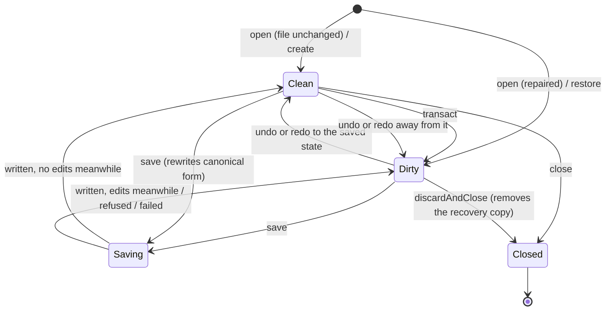

# Data Model: Document Model

The types in `apps/pyro/lib/document/`. Node classes, `Scene`, `SceneCodec`, `RepairReport`
and `SceneFormatException` are `pyro_runtime`'s ([spec 001 data model](../001-scene-format/data-model.md))
and are used unchanged. Signatures are in [contracts/document-api.md](contracts/document-api.md);
decisions cited as R*n* are in [research.md](research.md).

## SceneDocument

One immutable state of a Scene. `@Freezed(equal: false)`: compared by identity (R4).

| Field | Type | Notes |
|---|---|---|
| `rootId` | `NodeId` | The root Node; never changes for a document |
| `nodes` | `IMap<NodeId, Node>` | Every Node by ID (R3) |
| `parents` | `IMap<NodeId, NodeId>` | The parent of every Node except the root (R2) |
| `sceneExtra` | `Map<String, Object?>` | The Scene's unknown top-level keys, unmodifiable, written back unchanged |

**Invariants** (true of every state; the edits keep them, `toScene` re-checks them through
`Scene`'s constructor):

1. `nodes[rootId]` is the only `RootNode`.
2. Every ID in a Node's `childIds` names a Node, appears in exactly one list, and isn't the root.
3. `parents[c] == p` exactly when `c` is in `nodes[p].childIds`.
4. Every Node is reachable from the root (no cycles, no orphans).
5. `nodes[id].id == id`.

**Derived:** `node(id)`, `parentOf(id)`, `childrenOf(id)`, `contains(id)`, `isAncestor(a, b)`
(walks `parents`, O(depth)).

**Conversion:** `SceneDocument.fromScene(Scene)` builds the maps once (O(n));
`toScene()` builds a `Scene` (O(n), once per save).

### Edits

Pure functions returning a new `SceneDocument`, or `this` when nothing changes (R6).

| Edit | Changes | Refuses with |
|---|---|---|
| `addNode(node, {parentId, index})` | inserts `node` into `nodes`, its ID into the parent's `childIds` at `index` (default: last), and `parents` | `DuplicateNodeId`, `UnknownNode` (parent), `RootNotAllowed` (a second root), `NodeHasChildren` (node.childIds not empty), `IndexOutOfRange` |
| `removeNode(id)` | removes the Node and its whole subtree from `nodes` and `parents`, and its ID from its parent's `childIds` | `UnknownNode`, `RootNotAllowed` |
| `moveNode(id, {parentId, index})` | removes the ID from the old parent's list, inserts it into the new one at `index` (default: last), updates `parents`; moving within one parent reorders | `UnknownNode`, `RootNotAllowed`, `MoveIntoOwnSubtree`, `IndexOutOfRange` |
| `replaceNode(node)` | swaps the Node with the same ID | `UnknownNode`, `RootNotAllowed` (to or from root), `ChildrenChanged` (node.childIds differs from the current list) |

No-ops that return `this`: moving a Node to its current parent and index; replacing a Node with
an identical object.

## HistoryEntry

| Field | Type | Notes |
|---|---|---|
| `label` | `String` | Shown as "Undo *label*"; for a coalesced run, the first transaction's label |
| `state` | `SceneDocument` | The state after the step |

The first entry is the opening state, labelled `'Open'` (never offered for undo).

## DocumentHistory

Pure; identity equality (R4, R5).

| Field | Type | Notes |
|---|---|---|
| `entries` | `IList<HistoryEntry>` | At most 201 (the opening state plus 200 steps, FR-014) |
| `index` | `int` | The current entry |
| `saved` | `SceneDocument?` | The state on disk; null for repaired and restored documents |
| `openCoalesceKey` | `Object?` | The key of the run in progress, or null |

**Derived:** `current` (= `entries[index].state`), `isDirty` (= `!identical(current, saved)`),
`canUndo`, `canRedo`, `undoLabel`, `redoLabel`.

**Transitions:**

| Operation | Result |
|---|---|
| `apply(label, next, {coalesceKey})` | `next` identical to `current` → `this`. Same non-null key as `openCoalesceKey` → replace the top entry's state, keep its label. Otherwise drop entries after `index`, append, trim to 201 from the front. `openCoalesceKey` becomes `coalesceKey` |
| `undo()` / `redo()` | Move `index`; clear `openCoalesceKey`. No-op (returns `this`) at the ends |
| `markSaved(state)` | `saved = state`; clear `openCoalesceKey` |

## OpenDocument

One open Scene as a value. Identity equality.

| Field | Type | Notes |
|---|---|---|
| `history` | `DocumentHistory` | |
| `path` | `String?` | Absolute path of the Scene file; null for a new Scene |
| `baseline` | `Digest?` | SHA-256 of the file's bytes as last read, written or (on restore) found; null for a new Scene (R8) |
| `repairs` | `RepairReport` | From opening; empty for new, restored and saved documents |
| `origin` | `OpenedFrom` | `file`, `repaired`, `restored` or `created` (for the editor's messages) |

**Derived:** `state` (= `history.current`), `isDirty`, `needsPath` (= `path == null`).

**Transitions:** `transact`, `undo`, `redo` delegate to `history`; `markSaved(SaveResult)` sets
`history.markSaved(result.state)`, `path`, `baseline`, and clears `repairs`.

## SaveResult

freezed value: `state` (the `SceneDocument` written), `path`, `digest`. Produced by
`SceneFiles.save`; applied with `OpenDocument.markSaved`, so edits made during the save stay
unsaved (FR-020).

## RecoveryInfo and RecoveryCheck

`RecoveryInfo` (freezed value): `projectRoot`, `scenePath`, `writtenAt` (`DateTime`, UTC),
`sceneFileModifiedAt` (`DateTime?`, null if the Scene file is gone), `key` (the file-name hash).

`RecoveryCheck` (sealed):

| Case | Meaning |
|---|---|
| `NoRecovery` | Nothing to offer |
| `RecoveryAvailable(info)` | A complete, readable copy; #1 offers *Restore* with both times |
| `RecoveryUnreadable(location, problem)` | A copy exists but can't be used; kept, and reported with its folder path (FR-029) |

## DocumentSession

Mutable holder for one open Scene (R13). Not a model: it owns the current `OpenDocument`, a
save queue and a `RecoveryTimer`.

**State machine:**

`close()` on a dirty session throws `StateError`: the caller must save or discard first, so
unsaved work is never dropped by accident. While dirty, the `RecoveryTimer` writes a copy every
30 s if the state changed since its last copy (R12).

## Errors

Every error's `toString()` names what failed and where (FR-030).

`DocumentEditError` (sealed, `Exception`): `DuplicateNodeId(id)`, `UnknownNode(id)`,
`RootNotAllowed(id, operation)`, `NodeHasChildren(id)`, `IndexOutOfRange(parentId, index,
length)`, `MoveIntoOwnSubtree(id, targetParentId)`, `ChildrenChanged(id)`. Each carries the Node
ID and, when known, the Node name.

`TransactionFailed(label, cause)` (`Exception`): what `transact` throws for a
`DocumentEditError`; the document is unchanged.

`SceneOpenFailed(path, cause)` (`Exception`): the file can't be read (missing, unreadable, not
UTF-8) or `SceneCodec.decode` threw a `SceneFormatException` (kept as `cause`).

`SaveRefused` (sealed, `Exception`), thrown before anything is written:

| Case | Fields | Meaning |
|---|---|---|
| `RuntimeVersionUnknown` | `path` | No readable version supplied (FR-022) |
| `RuntimeTooOld` | `path`, `reads`, `writes` | The Runtime can't read what Pyro writes; suggest *Upgrade runtime* |
| `SceneChangedOnDisk` | `path` | The file's bytes differ from the baseline, or it is gone (FR-019a) |
| `SaveTargetExists` | `path` | "Save as" or a first save onto an existing file |
| `SavePathRequired` | — | A new Scene saved without a path |

`SaveFailed(path, cause)` (`Exception`): the write itself failed (folder missing, permission,
disk full); the target is untouched and the temporary file removed when possible.

`RecoveryWriteFailed(location, cause)`: reported through the session's error stream, never
thrown into an edit; editing goes on.
