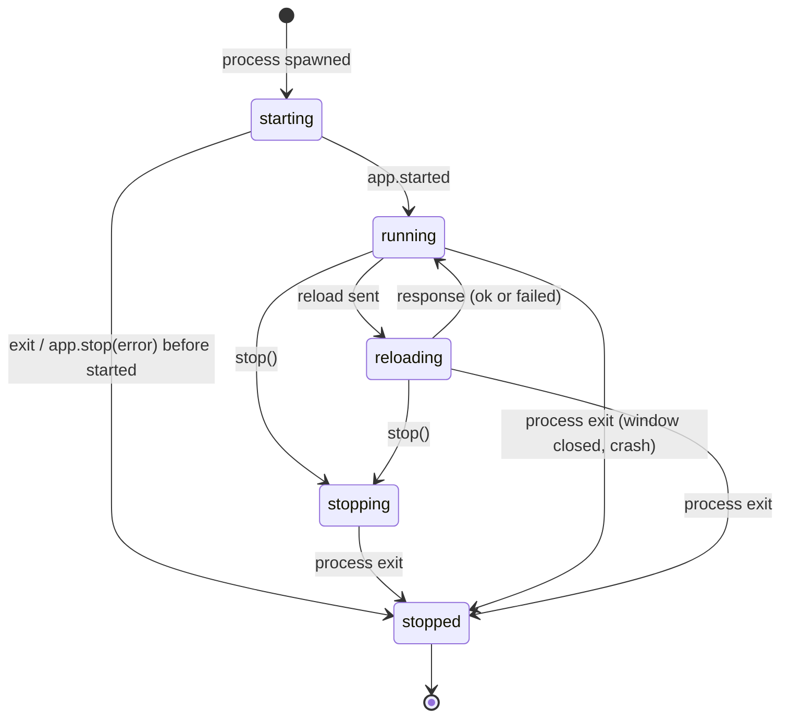

# Data Model: Vertical Slice

Phase 1 of [plan.md](plan.md). The slice adds no file format: the Scene, Registry and Manifest are
specs 001 and 003's. What is new is the Play client's runtime state, below, and the shape of
`example/` ([contracts/example-game.md](contracts/example-game.md)).

## PlayClient (`apps/editor/lib/process/`)

Starts Play sessions. It is stateless apart from its injected seams.

| Field | Type | Notes |
|---|---|---|
| `flutter` | `String` | executable; default `'flutter'` (on `PATH`) |
| `startProcess` | `ProcessStarter` | default `Process.start` (research R3) |
| `fileSystem` | `FileSystem` (`package:file`) | default `const LocalFileSystem()`; every file check goes through it (R3) |
| `watchDirectory` | `Stream<FileSystemEvent> Function(Directory)` | default `dir.watch(recursive: true)` (R7) |
| `quietPeriod` | `Duration` | 150 ms (R8) |
| `stopTimeout` | `Duration` | 5 s before SIGTERM, then 2 s before SIGKILL (R10) |

`Future<PlaySession> start(String projectPath)` fails fast, before spawning, when the path has no
`pubspec.yaml` or no `macos/` folder (`PlayStartException`, R11). Otherwise it returns a session
whose first event is `PlayStarting`.

## PlaySession

One run of a project, from spawn to exit. It is mutable and owned by its caller. Its outputs are an
event stream and a state value.

| Field | Type | Notes |
|---|---|---|
| `projectPath` | `String` | absolute |
| `state` | `PlayState` | see transitions |
| `appId` | `String?` | from `app.start` |
| `events` | `Stream<PlayEvent>` | single-subscription, closed after `PlayStopped` |
| `exitCode` | `Future<int>` | completes when the process has exited |

Methods: `Future<ReloadResult> reload()` (manual, no debounce; it errors when not running) and
`Future<void> stop()` (idempotent).

Private state: `_pending` (request id → completer), `_nextId`, `_changed` (paths since the last
reload), `_inFlight` (`Future?`), `_queued` (`bool`), `_quietTimer`, `_tail` (the last 20 redacted
output lines, for start errors).

### States

Rules:
- Scene changes are watched from the spawn. In `starting` they are held, and one reload for all
  of them is sent on `app.started`. The game can read its Scene before the daemon reports the
  start (ARCHITECTURE.md, "Vertical slice" finding 1). The Runtime ignores that reload if the game
  already read the new file.
- At most one request of `app.restart` is outstanding. A change during `reloading` sets `_queued`.
  When the response arrives and `_queued` is set, one more reload runs for all paths collected
  meanwhile (R8).
- `stopped` is final. The watcher is cancelled, pending requests fail with a
  `StateError` naming the stopped session, and the stream closes.

## PlayEvent (sealed)

What the session tells its caller, in order. None carries the VM service URI (R5).

| Event | Fields | When |
|---|---|---|
| `PlayStarting` | `command` (`flutter run --machine -d macos --debug`), `projectPath` | spawned |
| `PlayDebuggerAvailable` | — | `app.debugPort` |
| `PlayStarted` | `appId`, `elapsed` | `app.started` |
| `PlayOutput` | `line` (redacted), `source` (`game`, `tool`, `stderr`) | any output line |
| `PlayReloading` | `paths` (project-relative, empty for a manual reload) | request sent |
| `PlayReloaded` | `elapsed` | response `code == 0` |
| `PlayReloadFailed` | `message`, `code?` | response with `code != 0`, or an error response |
| `PlayFailed` | `message`, `exitCode?`, `outputTail` | start failed (R11) |
| `PlayStopped` | `exitCode`, `requested` (`bool`) | the process exited |

`PlayOutput.source` comes from where the line arrived. `app.log` and raw stdout lines are `game`.
`app.progress` and `daemon.logMessage` are `tool`. stderr lines are `stderr`.

## Daemon message (internal)

A decoded daemon line is one of `DaemonEvent(name, params)`,
`DaemonResponse(id, result | error)` or `RawLine(text)`. Parsing is a pure function from one
stdout line to `List<DaemonMessage>`. It is total: anything it doesn't recognise is a `RawLine`
(R4).

## ReloadResult

`{bool ok, String? message, Duration elapsed}`. It is returned by `reload()` and mirrored as
`PlayReloaded` / `PlayReloadFailed`.

## Validation and errors (constitution I)

| Error | Names |
|---|---|
| `PlayStartException` | the project path and what's missing (`pubspec.yaml`, `macos/`), or the executable and OS error |
| `PlayFailed` event | exit code and the last 20 redacted output lines |
| `PlayReloadFailed` event | the daemon's message (compile errors name file and line) |
| Scene errors | not the client's: the Runtime prints `══ Pyro couldn't Hot-swap <path> ══` with the Scene, Node and Type ID, and it arrives as a `PlayOutput` |

## Example game state (for the checks)

| Value | Where | Survives a Hot-swap? | Used by |
|---|---|---|---|
| seconds counter | `ExampleGame` HUD | yes (outside the Scene) | US3 #2 |
| Hot-swap count | `ExampleGame`, incremented in `onReloaded` | yes | US3 #2–#4, SC-005 |
| `codeMarker` | `lib/code_marker.dart` constant, shown in the HUD | changes on a Dart reload | US3 #4 |
| ship angle | `Spin` on `ship` | reset by a swap (new components), kept by a no-op reload | US3 #3 |
